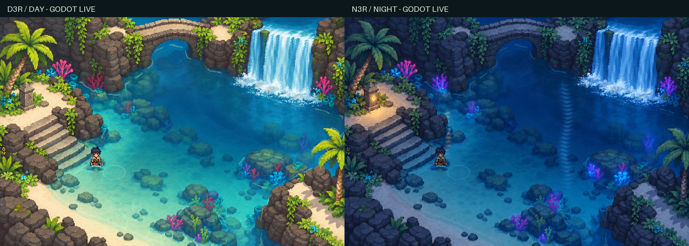

# Pixel Art Water VFX Demo

使用 Godot 4 实现《星之海》风格的通透像素水体。包含白天与夜晚场景、角色入水、交互涟漪和运行中调参，附设计说明、生成素材来源与实机验证记录。



[观看 2 分 58 秒技术演示](media/video/pixel-water-shader.mp4) · [快速运行](#快速运行) · [调参指南](docs/guides/parameters.md) · [技术说明](docs/water-vfx-design.md)

## 效果

- 通透海床与深浅渐变，按像素取整的折射和水下焦散。
- 距离场驱动的岸线泡沫，点击、移动与按键触发的涟漪。
- 角色渐进浸没、曲面水线、水下染色、倒影与前景遮挡。
- 宽瀑布、落点扰动和汇流波，夜间冷月光与暖灯反光。
- 158 项运行中美术参数，支持默认值恢复、命名预设与 JSON 导入导出。

场景在 480×320 的二维视口中绘制，采用最近邻采样与整数放大。默认演示为石桥清潭，原始洞窟实验保留为兼容场景。

## 快速运行

已验证环境：**Godot 4.7.2，Compatibility 渲染器**。

1. 获取本仓库，使用 Godot 导入 [`demo/project.godot`](demo/project.godot)。
2. 等待贴图和着色器导入完成，按 **F5** 运行。
3. 默认自动漫游；按移动键或点击场景即可接管，右上角切换白天与夜晚。

也可以在仓库根目录运行：

```sh
godot --path demo --editor
# 直接运行
godot --path demo
```

工程已包含生成后的贴图与技术遮罩，运行只需要 Godot。Python 用于可选的素材处理、文档生成和检查；视频配音工具独立放在制作目录。

| 操作 | 功能 |
| --- | --- |
| WASD / 方向键 | 移动角色 |
| 点击场景 | 前往目标；点击水面触发涟漪 |
| 空格 | 在角色出水位置触发涟漪 |
| Tab | 在原始底图与实时效果间切换 |
| P | 冻结 / 恢复时间 |
| R | 重置场景，保留手调参数 |
| F12 | 保存运行截图到 `demo/captures/` |

完整操作、预设规则与参数范围见[运行指南](docs/guides/running.md)、[调参指南](docs/guides/parameters.md)和[参数参考](docs/guides/parameter-reference.md)。

## 演示与文档

| 想了解什么 | 入口 |
| --- | --- |
| 完整效果与三分钟技术拆解 | [成片](media/video/pixel-water-shader.mp4)、[字幕](media/video/subtitles.srt)、[章节](media/video/chapters.txt) |
| 日夜切换与角色入水 | [30 秒实机录像](media/demos/day-night.mp4) |
| 手动调参是什么样 | [面板演示](media/demos/parameter-workbench.mp4)、[面板截图](media/images/parameter-workbench.png) |
| 各种效果如何实现、如何组合 | [设计与技术说明](docs/water-vfx-design.md) |
| 概念选择、迁移过程与踩坑 | [实验复盘](docs/water-vfx-retrospective.md) |
| 素材与参考从哪里来 | [素材来源](docs/assets/README.md)、[技术参考](docs/references.md) |
| 如何验证与继续修改 | [贡献与验证](CONTRIBUTING.md)、[验收索引](evidence/README.md) |
| 如何重新制作视频与封面 | [制作说明](docs/video-production.md)、[制作工程](production/video/README.md) |

所有阅读入口见[文档索引](docs/README.md)。

## 项目结构

```text
demo/               Godot 工程、运行脚本、着色器与生产贴图
docs/               运行指南、技术说明、实验复盘与素材来源
media/              当前成片、封面、音轨、实机演示与旧版归档
production/video/   视频与封面的制作代码、分镜、配音及取景素材
tools/              技术遮罩生成、参数文档生成、检查和打包工具
designs/            各轮概念图、提示词与采用记录
evidence/           按实验阶段保存的截图、报告和验证证据
.local/             本机工作文件及压缩包，不纳入 Git
```

运行代码从 [`demo/scripts/main.gd`](demo/scripts/main.gd) 开始。水面合成在 [`water.gdshader`](demo/shaders/water.gdshader)，角色浸没在 [`character.gdshader`](demo/shaders/character.gdshader)，参数与预设共用 [`water-parameters.json`](demo/assets/water-parameters.json)。目录职责和旧路径对应关系见[目录说明](docs/repository-layout.md)。

## 开发与验证

```sh
# 检查仓库内部链接、资源引用和交付文件
python3 tools/verify_repository.py

# 可选图像工具依赖
python3 -m pip install -r requirements-dev.txt

# 根据实际定义重新生成参数参考
python3 tools/generate_parameter_reference.py

# 在真实图形会话中重新验证场景，然后检查截图
godot --path demo --script res://scripts/audit_stone_basin.gd
python3 tools/check_stone_basin_render.py
```

已有结果覆盖 158 项参数、日夜场景、默认画面保持、像素网格和遮罩边界。具体设备、测试时间与适用范围见[验证记录](evidence/README.md)。

## 实现边界

本项目采用二维视觉近似。水深与反光锚点按场景校准，潮位不会移动岸线；角色使用四方向素材加程序摆动。黄昏仅保留概念稿。详细边界与迁移方法见[技术说明](docs/water-vfx-design.md)。

## 素材与许可

场景与角色素材由 ImageGen 生成，提示词、输入与实际输出均有来源记录。像素字体、配音模型和音乐的来源分别保留在制作工程中。

目前尚未添加项目级 `LICENSE`；第三方组件与素材的许可见[素材与许可索引](docs/assets/README.md)。
