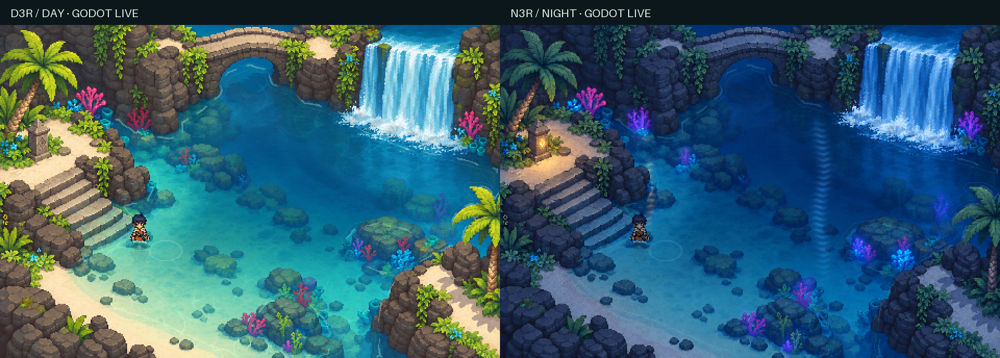
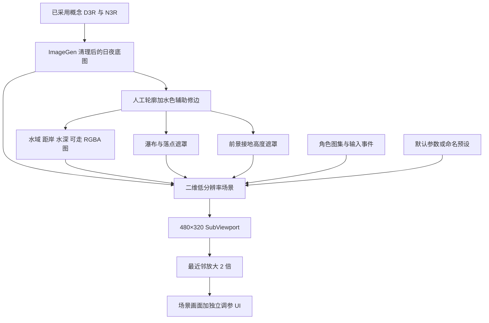
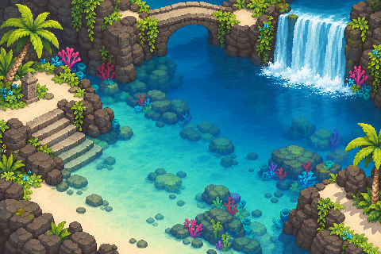
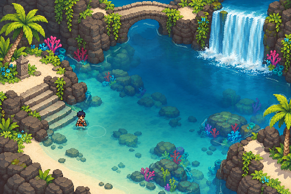

# 像素水体设计与技术说明

本文面向美术与开发，解释当前石桥清潭的白天、夜晚效果如何组成。实现依据为源码提交 `0fe0c87`，文档整理于 2026-11-02。设计过程另见[完整实验复盘](water-vfx-retrospective.md)，操作与完整默认值见[手工调参](../tidal-grotto/docs/parameters.md)和[参数参考](../tidal-grotto/docs/parameter-reference.md)。

## 先看最终效果



画面要表达的是一片可进入、可观察水底、有持续水流的石潭。浅滩能看清石阶与海床，往深处水色变暗；岸边有断续往复的泡沫，人物入水后身体逐渐染色、变淡，接触水面的位置出现水线与涟漪。右上宽瀑布持续落下，落点扰动向主水域传播。夜晚保留地形辨识度，用冷月光、暖灯反光和珊瑚原画的局部发光建立光色关系。

- [30 秒白天、夜晚实机演示](../stone-basin-day-night-demo.mp4)
- [运行中调参演示](../parameter-workbench-demo.mp4)
- [最初洞窟实验演示](../tidal-grotto-demo.mp4)

以上为项目自己的录像。静态截图只能说明颜色、边界与层次，速度、扩散、冻结和参数切换请结合视频或运行项目观察。

## 1. 设计思路：把美术、空间含义和运动分开

本项目采用“ImageGen 美术底图 + 显式语义数据 + 二维实时效果”。这样既保留生成场景的像素簇、石材与植被，也能单独控制水面运动。水域在哪里、哪里能走、人物该被什么挡住，都由技术数据决定。

场景选择也服务于观察效果。左侧石阶从干地进入浅水，给角色浸没提供连续参照；中央保留大块开放水面，容纳焦散和涟漪；后方石桥提供可辨认的倒影来源；礁石与前景棕榈检验前后遮挡；整幅宽瀑布提供持续的流动来源。石桥在当前版本中是环境结构，没有桥面行走层。

生成图中先清理预画角色、倒影、涟漪、大面积反光和明显的水面特效。仍保留海床水色、瀑布原画与落水白沫。底图本身已有一部分水的观感，关闭实时效果后仍是静态水景，不能把它叫作干燥海床。

用户提出的“适度归约细节”落实为合并相近色块，减少碎亮点、颗粒砂纹和密集白线。柔和感来自色阶与形状组织。实时焦散、泡沫、反光各有运动，底图越碎，叠加后越容易闪烁或抢走角色的注意力。

## 2. 数据如何流到画面



技术图由 [build_stone_basin_maps.py](../tidal-grotto/tools/build_stone_basin_maps.py) 生成。Python 在这里制作数据，不重画美术。

| 数据 | 编码 | 参与的效果 | 为什么单独保存 |
| --- | --- | --- | --- |
| 水域 | `bathymetry.png` 的 R 通道 | 水体绘制、折射边界、倒影和涟漪范围 | 水下石块也是水域，不能只按它的颜色判断 |
| 距岸距离 | G 通道，读取时乘 64，还原逻辑像素距离 | 岸线泡沫、贴岸抑制 | 同一等距带能跟随弯曲岸形 |
| 水深 | B 通道，0 到 1 的拟合值 | 水色、焦散衰减、角色浸没 | 是美术控制量，不是以米计的真实深度 |
| 可走范围 | A 通道 | 点击寻路、自动漫游与阻挡 | 岸上可走、水中可走和水域不是同一个概念 |
| 瀑布与落点 | `waterfall-mask.png` 的 R、G 通道 | 下落水幕、落水白沫 | 两个区域需要不同运动 |
| 物件接地高度 | `occlusion-mask.png` 的 R 通道 | 前景遮挡 | 决定人物何时在物件前，何时在物件后 |

水深先由手工水盆轮廓的欧氏距离场拟合，近似为 `clamp(distance / 62, 0, 1)^1.05`，再乘纵向修正。最终水域还经过水色辅助修边、补洞和礁石排除，因此水深源轮廓与最终水域边界并不完全相同。距岸 G 通道则由最终水域重新计算。

这些图必须按数据导入。项目设置 `process/fix_alpha_border=false`，避免透明边缘修复改写 RGB 通道，且使用最近邻采样。图像导入选项的含义见 [Godot 官方导入说明](https://docs.godotengine.org/en/stable/tutorials/assets_pipeline/importing_images.html)。

## 3. 实际绘制顺序

从后往前，节点顺序由 [main.gd 的 `_build_world`](../tidal-grotto/scripts/main.gd) 建立：


水面内部先决定折射采样位置，再读取海床颜色，依次混合深浅色、焦散、泡沫、环境反光、汇流亮部与交互涟漪。顺序会影响结果，例如泡沫需要盖在水底纹理上，角色必须单独处理水下部分，最后的前景层才能把站在礁石后方的人物遮住。

当前水体直接采样明确传入的 `seabed` 贴图，没有读取屏幕纹理，也没有 `BackBufferCopy`。五个着色器均为 Godot `canvas_item`；水面、瀑布和角色用 `unshaded`，光色由底图与程序混色控制。基础语义见 [CanvasItem shaders](https://docs.godotengine.org/en/stable/tutorials/shaders/shader_reference/canvas_item_shader.html)。

## 4. 每项技术怎样影响画面

### 4.1 深浅水与清澈度

水面从原图采样海床，再按拟合水深混入浅水色与深水色。日景和夜景各自有基准色，共享用户的 HSV 相对调整。

简化关系如下，对应 [water.gdshader](../tidal-grotto/shaders/water.gdshader)：

```text
depth = clamp(B + water_level × tide_influence, 0, 1)
tint = mix(shallow_color, deep_color, depth)
mix_amount = clamp((water_mix + depth × deep_mix) × (1.15 − clarity × 0.55), 0, 1)
water_color = mix(sampled_seabed, tint, mix_amount)
```

提高清澈度会减少覆盖在海床上的水色，更容易看见水下石块。增加深水混合会强化深处的蓝色和遮蔽感。这里是可控的颜色混合，没有求解真实光线吸收。

潮位偏移同时影响水色深度与角色浸没，但水域 R 通道保持固定。因此调潮位不会让岸线扩张，也不会把新的干地淹没。

### 4.2 像素折射

两组斜向正弦波构成缓慢变化的二维位移，角色涟漪与瀑布汇流还会追加位移。采样位置按逻辑像素取整，若移到了岸外就退回当前位置。

视觉上，水下石头会轻微摆动，岸上岩石与砂岸保持稳定。整数采样维持像素边缘；幅度过大则容易产生跳格和扭曲。`strength` 只缩放折射位移，调到 0 不会停止焦散、泡沫、瀑布或高光动画。

### 4.3 水底焦散

项目用嵌套正弦函数生成网状亮线，再用断续函数打破规则感。它随深度减弱，并在贴岸处淡出，避免岸边堆满亮点。它没有做光线追踪，也没有使用教程中的焦散贴图。

焦散让浅水看起来有阳光穿透，折射则让水底轮廓发生位移，两者提供不同线索。焦散强度、密度和线宽一起拉高，会把安静水面变成白色网格。默认设计选择较低对比与较大色块，留出人物水线的辨识空间。

### 4.4 岸线泡沫

泡沫在“到岸边的距离”上取一个移动带，而不是沿画面 x、y 直接画直线。带的位置随时间往复，再叠加小幅起伏和断续门控；更外侧有一条较弱的回流线。

这样不规则岸线也能形成一致的接触关系。泡沫线宽决定厚薄，强度决定显眼程度，距岸偏移决定是否贴岸。几项同时增加会形成大块白边，遮住原本清楚的浅滩。

### 4.5 交互涟漪

点击水面、按空格和水中移动都会创建事件，记录中心、出生时间与强度。16 个循环槽保存这些事件。着色器用椭圆距离生成向外扩散的环，随着寿命逐渐衰减，同时增加局部折射和高光。

椭圆比例配合俯视角；移动涟漪取角色当前出水位置，避免脚下冒泡而身体接触线在别处。触发间隔过短且寿命过长会堆叠成持续亮斑，甚至挤掉较早事件。

### 4.6 宽瀑布、落点与主水域汇流

这部分由三个相连的信号组成：

| 区域 | 实现 | 可见作用 |
| --- | --- | --- |
| 下落水幕 | 对原画做两组相差半周期的向下滚动采样，交叉混合并叠加流纹亮暗 | 保持统一宽水幕，减轻单次循环重置的突跳 |
| 落水白沫 | 在落点遮罩内做椭圆径向扰动与轻微亮度变化 | 表现持续翻动的落水接触区 |
| 主水域 | 从落点向外传播的径向波，按距离指数衰减，加入折射与弱高光 | 让瀑布的动势延伸进石潭 |

水幕和落点见 [waterfall.gdshader](../tidal-grotto/shaders/waterfall.gdshader)，汇流见 [water.gdshader](../tidal-grotto/shaders/water.gdshader)。水幕、落点和汇流分别调速，以符合各自的运动尺度，未做流量守恒或粒子流体模拟。源图已有静态水幕，关闭瀑布效果会回到静态水幕。

### 4.7 角色渐进浸没

角色脚点先从地图 B 通道读出深度，换成 0 到 0.96 的归一化浸没量。角色着色器再估计精灵局部高度：

```text
local_height = 1 − local_y + (abs(local_x − 0.5) × 2)^2 × 0.065
surface = immersion × waterline_height + 小幅时间波动
局部高度低于 surface 的像素进入水下处理
```

横向二次项使水线带弯曲感。它是可行的二维近似，不是角色真实体积，也不是逐帧手绘高度图。水下区域偏青、变暗、降低透明度并横向扰动，接触线增加窄亮带与邻域边缘。针对大头角色，默认水线高度倍率设为 0.55，再配合下沉偏移，深水仍保留头部可读性。

代码在 [character.gdshader](../tidal-grotto/shaders/character.gdshader) 和 `main.gd` 的 `_refresh_character`、`_surface_point`。局部高度与地图深度分开后，更换水深不会要求给每个浸没等级再画一张角色。

### 4.8 倒影、夜间反光与前后遮挡

角色倒影使用翻转精灵副本，纵向压缩、染色、波动，并由水域遮罩限制。随着人物浸入水中，倒影会减弱。它与水下身体分开绘制，分别表现水面上的镜像与水下的可见身体。见 [reflection.gdshader](../tidal-grotto/shaders/reflection.gdshader)。

桥身倒影从底图中采样桥的颜色，投影到手工限定的水域区域，再做压缩与扭曲。月光和暖灯用手工锚点生成横向衰减、纵向限长的破碎光带，仅在夜间加入。它们没有镜像相机，也不会自动反射新增的所有场景物件。

前景遮挡在角色之后绘制。遮挡图记录礁石或棕榈的接地 y，角色脚点位于物件后方时，重画该物件的原图像素。人物走到前方时停止覆盖。叶间水面从遮挡数据中排除，避免叶片间隙变成静态色块。见 [occlusion.gdshader](../tidal-grotto/shaders/occlusion.gdshader)。

## 5. 组合后的视觉关系

| 需要读出的现象 | 主导技术 | 配合项 | 单独使用的不足 |
| --- | --- | --- | --- |
| 水是清澈且有深度的 | 海床底图、深浅着色 | 深处焦散衰减、轻折射 | 只有蓝色混合会像一层滤色 |
| 水面在缓慢运动 | 折射 | 低对比焦散、断续泡沫 | 只有闪动亮线不一定能读成水流 |
| 水与岸接触 | 距离场泡沫 | 浅滩色阶、岸外采样拒绝 | 白边若越过干地，会破坏空间关系 |
| 瀑布确实汇入石潭 | 水幕流动 | 落点翻动、向外汇流波 | 只有下落贴图会像悬挂的动画幕布 |
| 人物正在进入水中 | 连续浸没与曲面水线 | 水下染色、透明度、倒影减弱、出水涟漪 | 只裁掉腿会显得人物被背景吃掉 |
| 夜晚仍能辨认水与地形 | 夜间底图与深浅基准色 | 破碎月光、暖灯反光、角色夜间色调 | 只压暗整图会丢失浅深和轮廓 |
| 物件有前后层次 | 脚点遮挡 | 可走数据与绕行 | 只用一张背景会让角色永远压在物件上 |

### 从已有截图观察层的作用

下列图取自[最新场景回归](../evidence/parameters/scene-regression/render-checks.json)。同一效果比较使用固定位置和时刻；底图模式本身不显示角色。九项效果都通过了可见差异检查，但变化像素多不等于美术质量更好。

| 清理后的静态底图 | 开启全部效果 |
| --- | --- |
|  |  |

| 关闭深浅着色 | 关闭焦散 |
| --- | --- |
|  |  |

| 深水中的渐进浸没 | 同一深水位置关闭浸没 |
| --- | --- |
|  |  |

## 6. 像素风格为什么能保持一致

场景在 480×320 `SubViewport` 内绘制，禁用 3D，用最近邻采样后放大 2 倍。水面位置、折射偏移与角色显示位置量化到逻辑像素，UI 在场景视口之外绘制。这样美术、倒影和水的细节共享像素尺度，数字与文字仍能清晰输入。

高分辨率生成图在这一采样管线中成为低分辨率场景，不应因此声称原始素材每个像素都经过手工设计。项目已有 GPU 截图的严格 2 倍像素网格检查；它检查显示一致性，不评价生成图的像素簇质量。视口与整数缩放的原理可参阅 [Godot 多分辨率说明](https://docs.godotengine.org/en/stable/tutorials/rendering/multiple_resolutions.html)。

## 7. 如何手工调整而不打散效果

当前有 158 项控制，包含 9 个效果开关与 16 个调色对象的 HSV 控制。原始默认值、有效范围、面板和预设校验共用 [water-parameters.json](../tidal-grotto/assets/water-parameters.json)。下表是调参起点，完整清单见[参数参考](../tidal-grotto/docs/parameter-reference.md)。

| 控制项 | 默认值 | 有效范围 | 增大后的主要变化 |
| --- | ---: | --- | --- |
| 清澈度 `clarity` | 0.65 | 0–1 | 海床颜色保留更多 |
| 折射强度 `strength` | 1 | 0–4 | 水底位移更明显，也更易跳格 |
| 焦散强度 `caustic_strength` | 0.27 | 0–2 | 浅水光纹更亮 |
| 焦散密度 `caustic_density` | 0.16 | 0.02–0.6 | 光纹更密，容易增加碎亮点 |
| 泡沫强度 `foam_strength` | 0.4 | 0–1 | 岸边白线更显眼 |
| 泡沫线宽 `foam_width` | 1 倍 | 0.1–5 倍 | 岸边白带更厚 |
| 涟漪寿命 `ripple_lifetime` | 2.8 秒 | 0.2–10 秒 | 环存在更久，重叠更多 |
| 涟漪速度 `ripple_speed` | 15 px/s | 0–80 px/s | 环扩散更快 |
| 水幕流速 `fall_speed` | 1.5 周期/s | 0–6 周期/s | 纹理循环下落更快 |
| 汇流折射幅度 `flow_amplitude` | 0.65 px | 0–4 px | 瀑布对周围水底的扰动更明显 |
| 汇流衰减距离 `flow_decay` | 90 px | 8–240 px | 汇流波影响更远 |
| 月光强度 `moon_strength` | 0.65 | 0–3 | 夜间冷光带更亮 |
| 水线高度倍率 `waterline_height` | 0.55 | 0–0.8 | 相同地图深度下，更多身体进入水下 |
| 水下透明度倍率 `under_alpha` | 0.36 | 0–1 | 水下身体更不透明 |
| 倒影基础透明度 `reflection_alpha` | 0.27 | 0–1 | 角色倒影更清晰 |

建议先确定浅深和清澈度，再调折射幅度与速度，随后看焦散和泡沫，最后调瀑布、角色与夜间光带。每次只改变一个效果组。先冻结时间比较颜色、边界与强度，再恢复时间检查速度；速度参数在冻结期间没有新的运动可供观察。

白天、夜晚共享调整值，但保留不同的基准色。相对 HSV 默认是色相 0°、饱和度 1 倍、亮度 1 倍。先在白天判断海床与水线，再切夜晚检查是否压暗过度或光带太亮。更改速度时系统补偿相位，避免整片图案突然跳到别处。

命名预设只由用户手动保存，JSON 保存参数和时段。加载时切换到保存时段，保留人物位置、场景时间、冻结和漫游状态。恢复参数默认值保留场景状态；重置场景保留参数与时段，并解除冻结。加载、导入、恢复默认、退出均不弹保存确认，也不自动保存。需要保留的调整应先命名保存或导出。

## 8. 迁移到另一张场景图时要改什么

可复用的是效果算法、参数面板和预设规则。场景数据需要重新校准：

1. 准备清理后的底图，移除会与实时效果重复的角色、泡沫、焦散和反光；保留可读的海床结构。
2. 标定水域、水盆、岸上平台、礁石、落水区域与可走范围，重建 RGBA 图。
3. 制作瀑布水幕、落点和物件遮挡图，检查棕榈等物件的镂空间隙。
4. 修改汇流中心、桥身采样区、月光和灯光锚点，校准角色比例、起点与漫游路径。
5. 检查贴图导入、低分辨率网格、岸外采样、角色前后关系与日夜对应。
6. 在真实窗口重跑输入和渲染检查，保存新的场景基线，再比较参数效果。

当前 [main.gd](../tidal-grotto/scripts/main.gd) 与两个环境着色器中仍有本场景坐标，尚未抽成通用场景配置。换一张背景就能运行，不代表语义边界、反光或碰撞已经正确。

## 9. 已证明的效果与边界

2026-11-01 保存的[最新调参验收](../evidence/parameters/README.md)记录了 Godot 4.7.2、Compatibility 渲染器、RTX 4070 SUPER 的真实窗口结果：158 项控制通过，27 项面板与预设检查通过，加入调参后默认日夜画面相对已采用基线均变化 0 像素。场景回归约为 60 FPS，岸外与瀑布越界修改均为 0。本文只核查这些已有记录，没有重新测量。

当前边界包括固定淹没区域、人工水深、手工反光锚点、四方向静态角色加程序摆动，以及未逐个建立体积和碰撞的水下石块。黄昏保留为概念稿，未迁入运行场景。参数可生效和边界不越界，并不证明所有参数组合都有合适的美术表现。

## 10. 代码与引用入口

| 阅读目的 | 入口 |
| --- | --- |
| 节点顺序、角色、寻路与时段切换 | [main.gd](../tidal-grotto/scripts/main.gd) |
| 水面各层合成 | [water.gdshader](../tidal-grotto/shaders/water.gdshader) |
| 水幕与落点 | [waterfall.gdshader](../tidal-grotto/shaders/waterfall.gdshader) |
| 浸没、倒影与前景 | [character](../tidal-grotto/shaders/character.gdshader)、[reflection](../tidal-grotto/shaders/reflection.gdshader)、[occlusion](../tidal-grotto/shaders/occlusion.gdshader) |
| 场景数据生成 | [build_stone_basin_maps.py](../tidal-grotto/tools/build_stone_basin_maps.py) |
| 默认值、校验、预设与面板 | [参数定义](../tidal-grotto/assets/water-parameters.json)、[parameter_store.gd](../tidal-grotto/scripts/parameter_store.gd)、[parameter_panel.gd](../tidal-grotto/scripts/parameter_panel.gd) |

最初的三个参考分别提供不同启发：

- Fishy Games 的 [How I Created 2D Pixel Art Water For My Indie Game](https://www.youtube.com/watch?v=DkfKwfjaVx0)提供独立水层、高度深浅、扰动、倒影与岸线动画的组合思路。本项目把其中部分思路改成距离场和函数图案。
- Reddit 的 [How did Sea of Stars render varying submersion on water?](https://www.reddit.com/r/gamedev/comments/1d3cdqq/how_did_sea_of_stars_render_varying_submersion_on/)讨论弯曲水线及高度映射。它支持把精灵局部形状与浸没深度分开考虑，属于社区方案讨论，不能证明《星之海》的官方内部实现。
- Red Giraffe 的 [How I Created Pixel Art Oceans | Pixel Perfect](https://www.youtube.com/watch?v=RU3EReALbEU)展示深度、折射、泡沫、反射与统一像素尺度的组合。本项目沿用二维近似，没有采用该视频的三维顶点波、深度缓冲或镜像相机。

YouTube 内容摘要依据实验期间保存的作者元数据和英文自动字幕，未完成视频逐帧核对。作者、章节定位、官方文档与核验范围统一记录在[参考与实现边界](../tidal-grotto/docs/references.md)。
