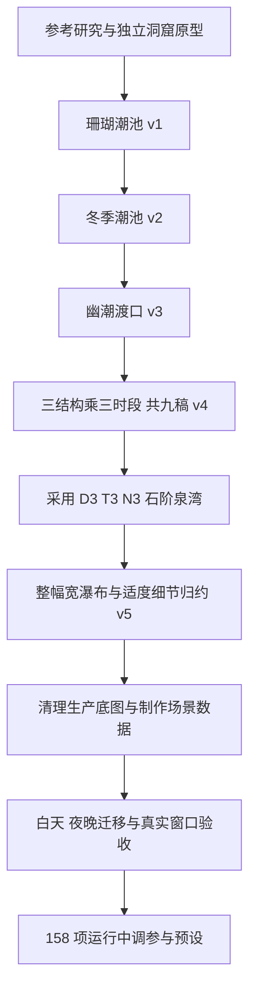
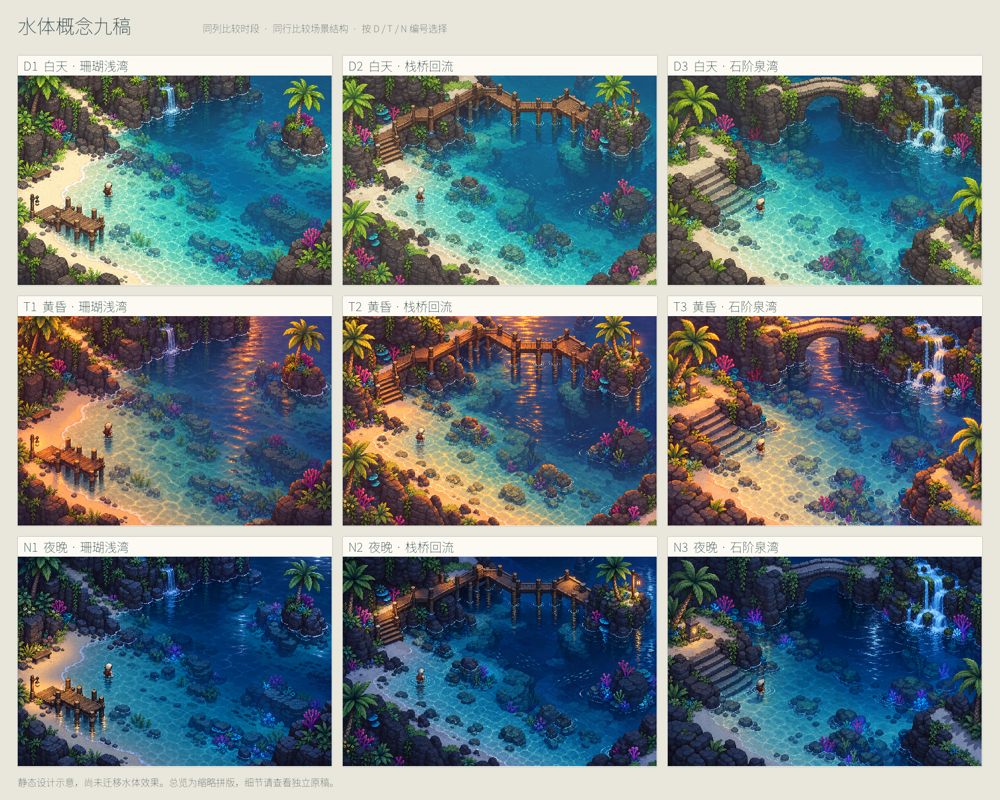
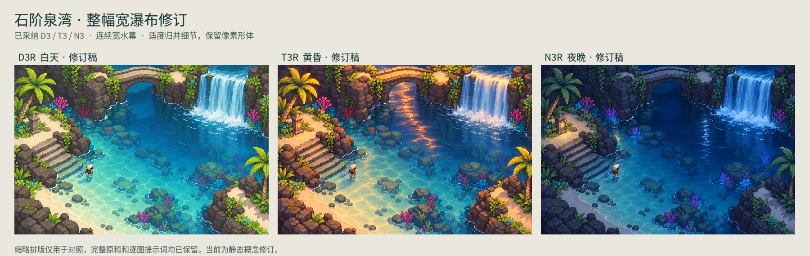
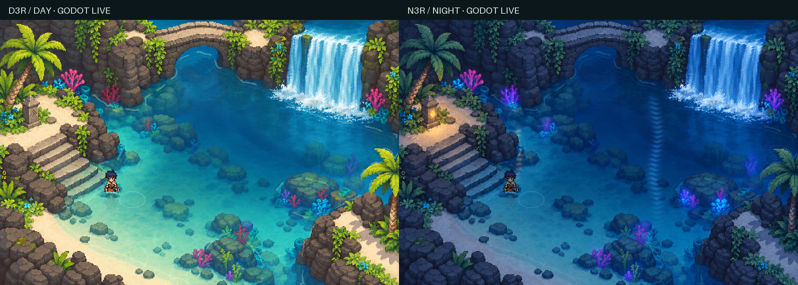
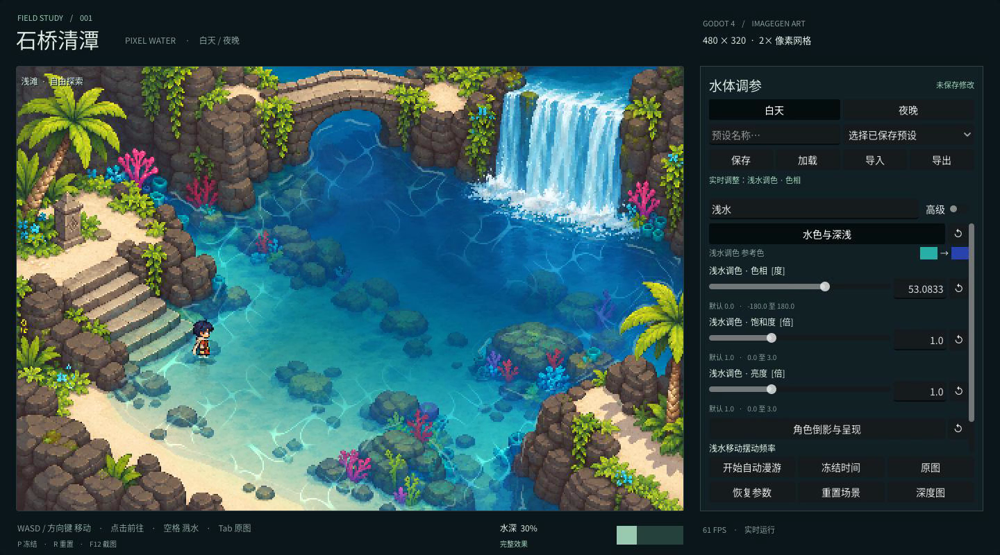

# 像素水体实验复盘

本文记录设计选择、实现过程、问题修正和验证依据。它与[设计与技术说明](water-vfx-design.md)分开：前者回答各阶段为什么这样做，后者解释当前效果如何组成。

实验与现有验收记录形成于 2026-11-01，本文整理于 2026-11-02。核查的源码基线为 `0fe0c87`。本文没有重新运行性能或图形验收，数字均指向已保存报告。

## 1. 实验问题与交付范围

最初的问题是如何在一个独立 Godot 4 Mini 项目中做出参考图那种清澈像素水体，并让角色入水时连续改变水线。美术素材用 ImageGen 生成。实验随后增加了场景设计、宽瀑布、白天与夜晚迁移，以及可手工调整的参数面板。

目前交付包括可运行的日夜石潭、生成美术与提示词、语义图生成方法、五个二维着色器、158 项控制、命名预设，以及实际窗口的截图、录像和验收报告。黄昏稿完成了设计，但没有迁入运行场景。

项目的核心选择是让生成美术负责材质和构图，显式数据负责空间含义，程序负责可控制的运动。这样既能保留图像风格，又能按效果逐项开关和比较。

## 2. 参考如何转成实验目标

| 输入 | 关注点 | 进入本项目的方式 | 不能由它证明的内容 |
| --- | --- | --- | --- |
| 用户提供的 JRPG 水景图 | 蓝绿浅深、暗岩壁、浅砂岸、水底物件、细白接触线 | 作为配色、材质、视角与可读性的参考，重新生成场景 | 静态图不能证明动态算法或帧率 |
| Fishy Games 的 [2D Pixel Art Water](https://www.youtube.com/watch?v=DkfKwfjaVx0) | 水与陆地分层、高度图、焦散、扰动、像素采样、倒影与岸线动画 | 建立多层水体实验，再分别实现和验证 | 视频算法不等于本项目的距离场、函数焦散实现 |
| Reddit 的 [varying submersion 讨论](https://www.reddit.com/r/gamedev/comments/1d3cdqq/how_did_sea_of_stars_render_varying_submersion_on/) | 水线如何围绕身体弯曲 | 将地图浸没深度与精灵局部高度分离 | 评论者的方案不代表《星之海》官方实现 |
| Red Giraffe 的 [Pixel Art Oceans](https://www.youtube.com/watch?v=RU3EReALbEU) | 深度、折射、波动、泡沫、反射和像素尺度统一 | 借鉴分层与统一采样原则，用二维近似对应 | 本项目没有使用其三维顶点波或镜像相机 |

两个视频的标题、作者、日期和内容摘要依据实验期间保存的作者元数据及英文自动字幕。此前视频流下载返回 403，未完成逐帧核验。Reddit 正文在文档核查时可读取。详细来源、章节链接与官方资料见[参考与实现边界](../tidal-grotto/docs/references.md)。

## 3. 从原型到当前版本

图中的 v1、v2、v3 是连续探索中保留的独立设计，未依次成为运行关卡。v4、v5 的静态设计确认与后来的程序迁移也是不同阶段。

### 3.1 开放洞窟原型

原型先解决水色、折射、焦散、岸线、角色倒影和渐进浸没。场景保持一片可从浅滩进入深水的开放水域，小岛与岩壁用于测试语义边界和绕行。

ImageGen 提供场景与四方向角色图，项目保留原图，再按实际尺寸裁切角色，并用 Python 制作水域、距离和深度等技术数据。第一阶段就加入原图查看、深度查看、单层开关、冻结、点击移动和自动往返，便于观察“这个变化来自哪一层”。

原型视频为[29 秒洞窟演示](../tidal-grotto-demo.mp4)，完整输入提示词与生成限制见[ImageGen 记录](../tidal-grotto/docs/imagegen.md)。初次代码提交为 `1243511`，原始证据保留在 `evidence/`，之后的旧场景回归另外保存。

### 3.2 三轮独立场景探索

| 版本 | 用户要求与设计处理 | 为水体测试留下的结构 | 当前状态 |
| --- | --- | --- | --- |
| [珊瑚潮池 v1](../designs/coral-tidepool-v1/README.md) | 按热带 JRPG 参考重新构图，暗岩、浅砂、珊瑚集中成组 | 中央开放水域、入水坡、右侧礁岛 | 静态设计归档 |
| [冬季潮池 v2](../designs/winter-tidepool-v2/README.md) | 使用冬季森林参考，加入积雪针叶树，填平左下狭长裂隙 | 保持液态主池和连续陆地，预留浅深过渡 | 静态设计归档 |
| [幽潮渡口 v3](../designs/drowned-landing-v3/README.md) | 采用幽暗遗迹参考，旧木平台、灰褐岩台、青绿色灯火 | 开放水面、低岸浅滩、木桩接触与灯火倒影目标 | 静态设计归档 |

这几轮说明了场景物件必须有合理支撑和路线连接，但尚未证明其中的雪、雨、灯火或倒影可以实时运行。每版都保留独立概念、提示词与元数据，没有覆盖原型场景。

### 3.3 九稿比较与石阶泉湾的选择

下一轮明确要求以水体为主角，白天、黄昏、夜晚各给三稿，并绘制结构合理的物件。最终形成三类结构：珊瑚浅湾、栈桥回流、石阶泉湾，每类都有三个时段。

用户选定 D3、T3、N3。石阶泉湾的优势是宽台阶可以从干地连续延伸到水下，便于观察渐进浸没；短石拱桥有明确的拱体和桥台，能为倒影提供辨认依据；物件集中在水面周边，中央仍然开放。

这些优势来自[视觉检查记录](../designs/water-study-nine-v4/review-notes.md)和最终构图，不能推断为桥面导航或所有水下物件碰撞已经完成。九稿中的小人物仅用来表达比例和水线，后续清理时移除，运行时继续使用原实验的独立角色图集。

### 3.4 宽瀑布与细节归约

用户要求把分段瀑布改成“一整个较宽的瀑布汇入水体”，并适度“归约细节灭高频冗余，软泛焦均质简谐流”。修订形成 D3R、T3R、N3R，归档提交为 `0bb745d`。

修改集中在两个地方。几何上统一崖口与水幕，保持桥、石阶和主岸线；细节上合并相近色块，减少岩面碎斑、砂纹、孤立亮点和细密焦散，同时保留物件轮廓、水底石阶和深浅关系。没有把“软泛焦”解释成全图模糊。

先改白天母稿，再以它约束黄昏和夜晚的构图。ImageGen 编辑仍可能改变细节，因此三张概念图不能直接当作像素完全对齐的运行贴图。采用后继续做生产清理，未将静态特效直接视作实时效果。

### 3.5 从概念转成日夜运行场景

迁移分为美术与数据两步。先用 ImageGen 从 D3R 移除预画角色和水面特效，保留海床与宽瀑布源图；夜景以清理后的白天为几何参考，以 N3R 为光色参考，去除预画的大块湖面光带。

再制作共享的水域、岸线距离、拟合水深、可走、瀑布与前景遮挡数据。共用技术数据可保持日夜的路线和边界一致，生成图中细节差异仍需通过实际画面检查。

原型七类水体效果迁入后，新增独立水幕、落水白沫、主水域汇流、桥身颜色投影、夜间光带与脚点遮挡。导航使用 2 像素 AStar 网格，确保自动路线能从岸边进入浅水、深水并返回。迁移提交为 `6ba9fa8`，随后 `0d4e60f` 保存 Godot 4.7 项目配置。

完整制作输入、哈希、提示词与首次验收见[日夜迁移记录](../tidal-grotto/docs/stone-basin/README.md)。[30 秒录像](../stone-basin-day-night-demo.mp4)展示的是运行场景，黄昏只保留在上面的设计归档中。

### 3.6 从演示开关扩展到手工调参

用户随后要求“各个参数可调，并提供默认值”。访谈最终确认运行中面板、完整美术控制、固定有效范围、保留已采用默认画面，以及手动管理预设。白天与夜晚共用调整值，用相对调色保留各自基准光色。

实现提交为 `0fe0c87`，共 158 项控制，包括 9 个效果开关、颜色相对调整与数值项。面板提供分组、常用与高级、搜索、滑杆、数值输入、默认值及逐项、整组、全部恢复。它只开放美术参数，像素分辨率、语义图格式、事件容量、构图锚点和导航结构保持技术设置。

最关键的状态约定是：

- 切换日夜保留共享参数；加载预设时应用参数并切换到保存时段，保留位置、时间、冻结与漫游状态。
- 恢复默认只处理参数；重置场景处理位置、时间、路径、临时涟漪和漫游，并解除冻结，保留参数与时段。
- 保存由用户明确执行，不自动保存；覆盖、加载、导入、恢复默认和退出不弹保存确认。
- 非法数值和损坏预设不部分应用。调速度时补偿相位，避免当前图案突跳。

选择经过多轮澄清，完整记录在[调参设计访谈](design/water-parameter-workbench.md)。[调参录像](../parameter-workbench-demo.mp4)与[手工说明](../tidal-grotto/docs/parameters.md)展示最终交互。

## 4. 实际遇到的问题与修正

| 问题与影响 | 修正 | 形成的经验 |
| --- | --- | --- |
| 角色 Alpha 存在接近透明的杂点，非零像素包围框把人物缩得过小 | 用 0.25 透明度阈值提取各朝向有效范围，按实际输出尺寸分格 | 生成提示尺寸和有效内容范围需要分别核实 |
| 粗水域轮廓切进岩壁，泡沫出现在岩石上 | 结合手工轮廓、水色辅助分类、补洞和局部排除 | 颜色分类可以修边，空间含义仍需显式定义 |
| 用像素颜色推断深度，把中性色的水下石块误判成浅滩 | 深度从连续水盆轮廓计算，可走区域单独制作 | 水下物件的颜色不等于水深或碰撞 |
| 直接朝点击目标行走，在凸岸卡住 | 加小网格绕行，验证完整往返路线 | 演示路线稳定，才能连续观察浅深过渡 |
| 大头角色按普通人比例淹没，把脸也吞掉 | 按角色比例调整水线倍率、下沉位移与出水涟漪点 | 水线算法还需要匹配具体精灵比例 |
| 遮罩导入的透明边缘修复把 RGB 写进透明像素，效果越过语义边界 | 技术图关闭 `fix_alpha_border`，检查岸外变化像素 | 数据贴图不能沿用普通美术图的所有导入设置 |
| 概念图已有焦散和白线，叠加实时层会双重表现 | 生产底图先做清理，再控制实时焦散的密度与亮度 | 概念图和运行底图用途不同 |
| 环境反光的幂运算遇负底数，产生无效颜色 | 先取绝对值，再做幂运算 | 函数图案需检查整个输入域，不能只看局部截图 |
| 前景棕榈宽轮廓盖住叶间水面 | 从遮挡数据中排除水色间隙 | 遮挡正确还包括物件镂空处 |
| 原图模式切进深度模式，角色显示状态未恢复 | 修正模式切换并加入检查 | 查看工具也有状态，需要独立验证 |
| 自动漫游检查受到测试按键释放时序干扰 | 等待输入帧完成，再开始模拟 | 先区分测试时序问题与寻路错误 |
| 每帧脚本赋值会覆盖直接修改的材质参数 | 用统一参数定义驱动脚本、面板与着色器 | 控件有读数还不够，必须证明效果确实变化 |
| 改变速度导致相位跟随累计时间跳动 | 保存相位偏移；涟漪扩散另补半径偏移 | 连续手调需要同时保证数值生效和运动连续 |

前半部分可追溯到[初版参考记录](../tidal-grotto/docs/references.md)，迁移问题见[迁移记录](../tidal-grotto/docs/stone-basin/README.md)，调参行为见[参数验收](../evidence/parameters/README.md)。

## 5. 证据如何组织，数字说明什么

验证同时检查交互、画面与参数效果。headless 用于导入检查，视觉和窗口帧率来自真实图形窗口。已有记录使用 Godot 4.7.2、OpenGL Compatibility、NVIDIA GeForce RTX 4070 SUPER。

| 阶段 | 主要证据 | 阅读时的边界 |
| --- | --- | --- |
| 初版洞窟 | [初版验证说明](../tidal-grotto/docs/validation.md)、`evidence/` 根目录 | 是旧场景结果，不代表新增的瀑布和遮挡 |
| 石潭首次迁移 | [运行报告](../evidence/stone-basin/runtime-report.json)、[像素报告](../evidence/stone-basin/render-checks.json) | 是调参面板加入之前的结果 |
| 最新参数与场景回归 | [验收索引](../evidence/parameters/README.md)、下方各报告 | 是当前源码基线的已保存依据 |
| 旧洞窟保留能力 | [旧场景回归](../evidence/parameters/legacy-regression/runtime-report.json) | 与当前石潭分开记录 |

### 最新验收结果

| 检查 | 已保存结果 | 能够支持的结论 |
| --- | --- | --- |
| [逐项参数覆盖](../evidence/parameters/coverage-report.json) | 158 项通过，失败列表为空；154 项 GPU 画面差异、4 项实际触发事件与间隔 | 每项控制实际生效，不是空面板 |
| [面板与预设](../evidence/parameters/runtime-report.json) | 27 项通过 | 覆盖真实鼠标、数值输入、焦点、共享参数、相位、恢复、错误与往返 |
| [默认画面对照](../evidence/parameters/default-baseline-checks.json) | 日夜均 0 改变像素，最大通道差 0 | 同位置、同时刻，排除 UI 后，默认效果保留 |
| [场景交互回归](../evidence/parameters/scene-regression/runtime-report.json) | 日夜均通过 | 覆盖键盘、点击、礁石阻挡、绕行、完整漫游、潮位及模式恢复 |
| [像素回归](../evidence/parameters/scene-regression/render-checks.json) | 岸外修改 0、瀑布越界 0、冻结变化 0，严格 2 倍网格通过 | 程序遵守当前遮罩与冻结时间，显示像素尺度一致 |
| 前后遮挡 | 人物在前方被误盖 0；后方遮挡差异 157 像素 | 已测位置的前后关系正确，不等于全图物件逐个通过 |
| 九个效果开关 | 日夜均有实际可见差异 | 每层在测试画面中确实参与结果 |

逐项测试将其他状态隔离，并在必要时选择非零潮位、合适位置或多个固定时刻。画面差异能证明参数生效，不能证明每一种组合都好看。

### 性能口径

项目维持 60 FPS 策略。最新普通窗口回归先预热，再进行约 3 秒短时测量：

| 指标 | 白天 | 夜晚 |
| --- | ---: | ---: |
| 实测窗口帧率 | 60.0083 FPS | 60.0068 FPS |
| Godot process 时间中位数 | 1.404 ms | 0.993 ms |
| Godot process 时间 P95 | 1.586 ms | 1.645 ms |

这些数字来自同一份[最新场景报告](../evidence/parameters/scene-regression/runtime-report.json)。process 时间是 Godot 监视器读数，不是整帧或独立 GPU 着色耗时。固定 60 FPS 下的结果也不能推断最大吞吐量或所有设备的性能。

此前石潭 Movie Maker 录像共 1801 帧，按固定 60 FPS 时间步长录制。其[录像报告](../evidence/stone-basin/recording-report.json)记录平均 CPU 渲染 0.14 ms、GPU 渲染 0.30 ms、编码 9.05 ms/帧。这是录像过程口径，与普通窗口 process 数据分开。视频标为 60 FPS 不构成游戏实时达到 60 FPS 的证据。

## 6. 尚未解决与尚未证明的部分

| 边界 | 当前状态 | 后续若要扩展需要做什么 |
| --- | --- | --- |
| 真实水深与潮汐淹没 | 人工归一化深度；潮位不改变岸线 | 引入可随高度变化的地形与水域判定 |
| 反射 | 手工区域投影、函数光带、翻转角色 | 若需任意动态物件反射，重新设计反射输入与遮挡 |
| 瀑布 | 原画采样与遮罩内扰动 | 若需改变瀑布几何或流量，补独立素材与结构模型 |
| 人物动作 | 四方向静态图加摆动、浮动与水下处理 | 制作行走、游泳等动作帧并重新校准水线 |
| 场景语义 | 主要河岸、台阶、礁石、落点与前景已校准 | 水下物件逐个建体积、碰撞和遮挡数据 |
| 黄昏运行版 | 仅保留 T3R 概念 | 制作清理底图、时段光色与完整验收 |
| 跨场景复用 | 算法可复用，坐标与轮廓仍含本场景配置 | 抽离锚点并对新图重建数据，不只替换背景 |
| 参数组合 | 逐项生效与指定流程通过 | 对极端组合、长期使用与美术预设另行审核 |
| 平台与性能 | 当前机器短时窗口结果 | 在目标设备和渲染环境分别测量 |
| 生成复现 | 提示词、输入输出、尺寸和哈希已记录 | 工具未提供固定模型版本与种子，不能承诺重生相同像素 |

## 7. 可以带到下一次实验的方法

先构造能暴露问题的场景。入水台阶比一片没有参照的深水更适合检查浸没，礁石和棕榈比空水面更适合检查遮挡，宽瀑布与主水域相接才有机会判断汇流是否连贯。

让每个空间含义有自己的数据来源。水域、深度、可走与遮挡不应混成一次颜色分类；它们在画面中相关，但对同一块水下岩石可能有不同答案。

在加入动态前先控制静态细节。原画中已经足够明亮的焦散和泡沫不会因为再加一层而更真实。清理底图和压低高频冗余，与着色器强度同样影响最终观感。

保留能对照的状态。单层开关、固定时刻、冻结、底图、深度图、恢复默认和基线截图，让“有变化”“变化来自哪里”“是否越界”分别有依据。它们也让手工调参能积累成可分享的命名预设。

## 8. 归档与阅读导航

- 想理解当前组合方法，读[设计与技术说明](water-vfx-design.md)。
- 想手工比较效果，读[调参操作](../tidal-grotto/docs/parameters.md)，配合[面板录像](../parameter-workbench-demo.mp4)。
- 想复查概念选择，读[九稿目录](../designs/water-study-nine-v4/README.md)与[宽瀑布归档](../designs/stone-basin-widefall-v5/README.md)。
- 想复查生成输入，读[初版提示词](../tidal-grotto/docs/imagegen.md)和[日夜迁移来源](../tidal-grotto/docs/stone-basin/README.md)。
- 想追踪证据，先读[最新验收索引](../evidence/parameters/README.md)，再按阶段查看原始报告。
- 想回到视频和教程，读[参考与实现边界](../tidal-grotto/docs/references.md)。

早期概念目录里的“尚未迁移”、`designs/selection.json` 中的 `migration_started:false` 是设计阶段留存的状态，不代表当前程序。本文保留这些历史档案的原文，并用迁移提交、当前代码与分阶段证据说明后续完成的工作。
